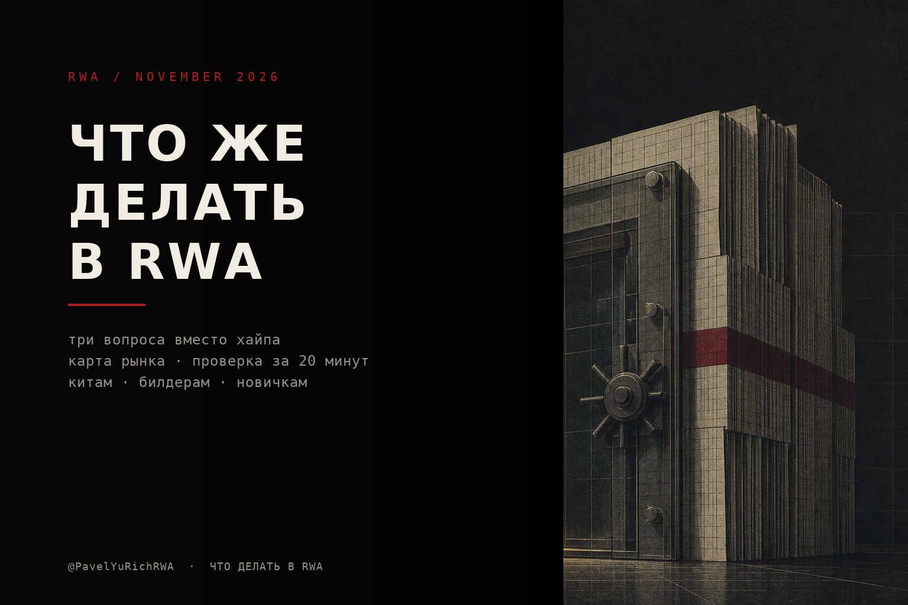
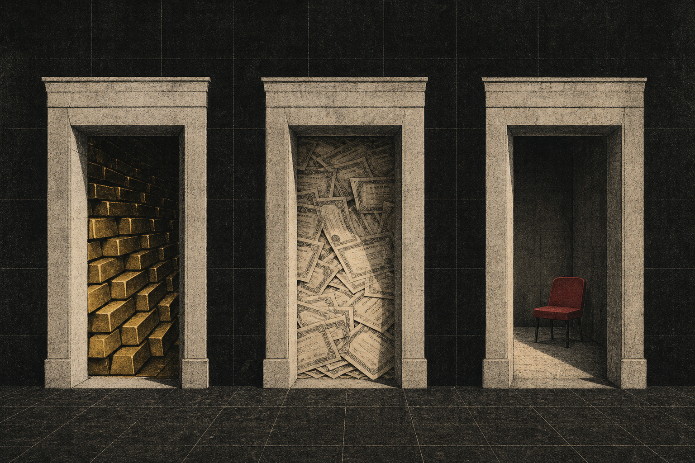
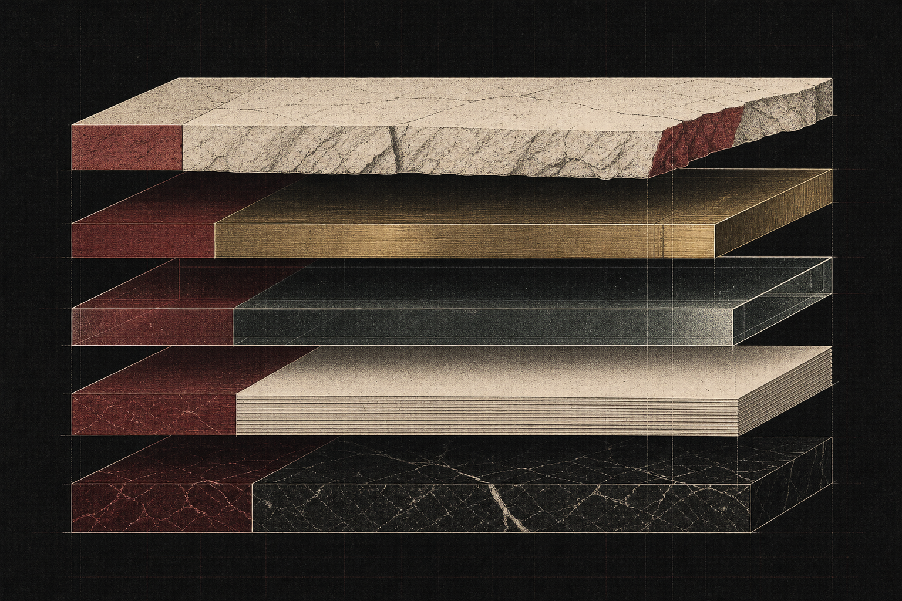
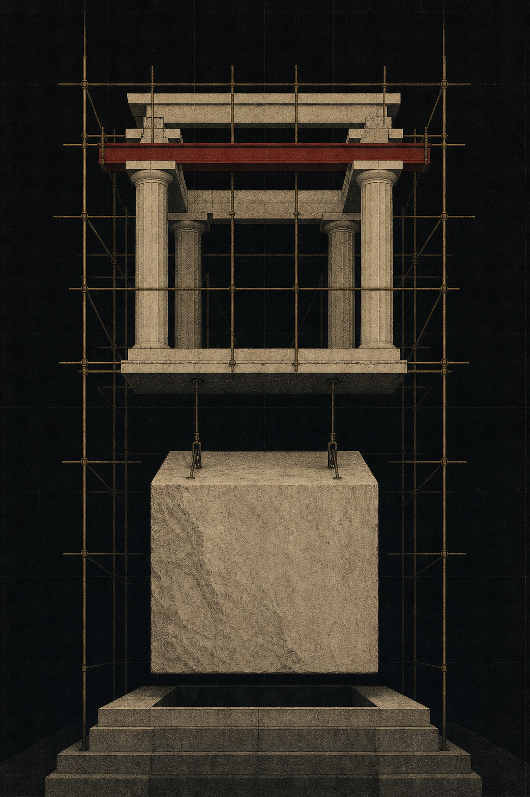

# Что же делать в RWA

Я почти год объяснял, что такое RWA. Хватит, объяснять больше нечего: рынок есть, деньги пришли, регулятор выписал разрешение, биржи дали листинги, банки подключили расчёт. Поэтому переходим к неприятной части, к тому, что с этим делать. Отдельно для тех, кто впервые слышит, отдельно для тех, кто уже покупал, отдельно для тех, у кого на счету столько, что можно не искать доходность, а создавать её.

И сразу главное, чтобы не было иллюзий. RWA это не про то, как купить акцию Apple в блокчейне. RWA это про то, кто ведёт учёт и кто может его переписать. Всё остальное, доходность, листинги, интеграции, это надстройка над этой простой вещью. Как только ты это понял, вопрос «какой RWA купить» становится куда менее интересным, чем вопрос «на каком этаже этой конструкции я вообще стою».

Договоримся по структуре, потому что статья длинная. Сначала три вопроса, которые отделяют настоящий RWA от красивого токена. Потом карта рынка, где что лежит и сколько платит. Потом проверка проекта за двадцать минут. Потом то, что интересно тем, кто в теме: стек, узкие места и где там маржа. Потом китам, что делать с капиталом, если хочется не просто заработать, а повлиять. Потом билдерам, которые хотят что-то выпустить. И в конце куда всё едет и что делать в понедельник.

## Три вопроса, которые отделяют RWA от токена

Первый вопрос: кто эмитент и что он физически держит. Не «партнёр», не «протокол», не «сообщество». Юрлицо, у которого есть кастодиан, счёт и лицензия. Если на сайте написано, что актив обеспечен, но не написано кем и где, это не RWA, это обёртка с логотипом.

Второй вопрос: чем ты владеешь по закону. Вот тут начинается взрослая жизнь. У тебя может быть доля в SPV, то есть в юрлице, которое держит актив. Может быть security entitlement, то есть право требования к брокеру, который держит бумагу за тебя. Может быть просто право требования к эмитенту токена, и это вообще не собственность, это долг. И может быть governance-токен, который не даёт ничего, кроме голоса в чате. Разница между этими конструкциями не в блокчейне, а в суде. Если завтра эмитент ляжет, ты будешь стоять в очереди кредиторов по-разному в каждом из четырёх случаев.

Третий вопрос: где выход и кто его закрывает. Не «мы работаем над вторичной ликвидностью», а «погашение в такие-то сроки, исполняет такой-то, при гейте происходит вот это». В частном кредите выход это часто не рынок, а окошко в двери, которое открывают по расписанию. И это нормально, просто надо знать заранее, а не в момент, когда деньги понадобились.

Вот и весь фильтр. Если по трём пунктам есть внятные ответы, можно смотреть на доходность. Если нет, доходность смотреть бессмысленно, потому что она в этом случае не доходность, а ставка в чужой игре.

## Карта рынка, где что лежит

Категорий немного, и они отличаются не темой, а физикой. Ниже грубая, но честная карта, по которой можно ориентироваться, не читая сто обзоров.

| Категория | Доход | Минимум | Выход | Кто главный риск |
|---|---|---|---|---|
| Трежерис и MMF | 3–5% | от $5 000 у OUSG, у BUIDL институциональный | ежедневное погашение по NAV | эмитент и кастодиан |
| Золото (PAXG, XAUt) | ноль, плюс DeFi-надстройки | от нескольких долларов | мгновенный, лучший вторичный рынок | кастодиан и аудит слитков |
| Токенизированные акции | цена плюс дивиденды | от $1 у Ondo | зависит от площадки, у многих 24/7 минт | брокер-держатель, юрисдикция |
| Частный кредит | 8–15% | часто от $100 000 | лок в месяцы, вторички почти нет | заёмщик и андеррайтер |
| Недвижимость | 7–12% ренты | от $50 | месяцами | застройщик и управляющий |
| Фонды и структуры | 6–12% | по правилам фонда | по правилам фонда | управляющий и платформа |

Три вещи, которые видно из таблицы и которые экономят годы.

Первое, доходность прямо пропорциональна тому, насколько тебе сложно выйти. Трежерис платят 3–5%, потому что выходишь в тот же день. Частный кредит платит 8–15%, потому что сидишь в локе и надеешься на андеррайтера. Это не рынок неэффективный, это рынок честный, он платит за то, что ты берёшь на себя.

Второе, единственный RWA с настоящим вторичным рынком это золото. Токенизированные трежерис технически торгуются, но обороты там смешные, потому что держателям не надо торговать, им надо парковать кэш. Акции оживают, но между сессиями и на тонких книгах. Всё остальное это не рынок, а очередь.

Третье, размер категории ничего не говорит о твоих шансах. Токенизированный частный кредит по широкому счёту это $12,9 млрд, но свободно обращающихся, пригодных к покупке токенов там около $5 млрд, остальное заперто внутри платформ ([разбор](https://github.com/Ricosworks1/blockchain-payment-flow-analysis/releases/tag/deep-dive-onchain-private-credit-12-9b-reality-sept-2026)). Разница в семьдесят процентов между заголовком и реальностью. Так что когда тебе показывают TVL, спрашивай не «сколько», а «сколько из этого я могу купить и продать».

Для новичка практический стартовый набор выглядит скучно, и это правильно. Золото как первый токен, потому что там всё проверяется глазами: есть ли аудит слитков, кто кастодиан, как погасить. Трежерис как второй шаг, потому что там надо понять разницу между NAV и обещанием. Акции как третий, потому что там начинается возня с юрисдикциями. Частный кредит строго после того, как ты научился читать документы, а не треды.

## Проверка за двадцать минут

Мне часто пишут «посмотри проект, стоит ли». Почти всегда хватает двадцати минут, чтобы понять, что смотреть нечего. Порядок такой.

Открой сайт и найди юридическое лицо. Не бренд, а юрлицо с номером регистрации. Дальше найди, кто кастодиан базового актива, и проверь, существует ли этот кастодиан отдельно от сайта. Если базовый актив это бумага, ищи брокера, который её держит. У Ondo, например, это Alpaca Securities, зарегистрированный американский брокер-дилер, и это ровно та строчка, которая отличает продукт от фантиков ([разбор механики](https://www.quicknode.com/blog/tokenized-equities-2026)).

Потом найди документы на погашение. Не раздел FAQ, а сам документ: сроки, кто исполняет, что при гейте, какие комиссии. Если документа нет, значит выход регулируется перепиской в поддержке, а это не выход, это переговоры.

Потом посмотри в контракте, какие роли есть. Кто может заминтить, сжечь, заморозить, переписать баланс, поменять правила. В нормальном security-токене этих ролей куча, и это не баг, а цена легальности. Важно другое: кто эти роли держит и есть ли у них таймлок. Если одна EOА-шная кнопка, ты не в ценной бумаге, ты в личном кошельке основателя.

Потом проверь NAV. Кто его считает, как часто, откуда берётся цена в контракте. Для трежерис это админ-функция, для кредита это оценка, для акций это оракул между сессиями. Ошибка в этом месте стоит дороже любого смарт-контрактного бага, потому что она тихая.

Потом посмотри на холдеров. Не на TVL, а на количество адресов и распределение. Фонд на $2 млрд с сотней холдеров это не рынок, это десять семей и их казначейства. И наконец посмотри на вторичный оборот за последние тридцать дней. Если его нет, всё, что ты купил, ты купил навсегда.

Красные флаги, которые видно сразу и которые не надо глубоко копать. Долларовая доходность выше двадцати процентов без плеча означает, что кто-то платит тебе за риск, который не хочет называть. Доходность из эмиссии токена это не доходность, это раздача твоих же денег обратно. Партнёрство без подписанного документа это мем. Аудит только контракта при полном молчании про SPV, кастодиана и резервы это классика. Обещание прав акционера без регистрации в реестре, за два года это уже проходили. И «вторичка будет позже», это не ответ, это отсрочка.

## Для тех, кто в теме. Стек, узкие места и где маржа

Вот здесь начинается самое интересное, потому что «купить BUIDL» это не позиция, это размещение кэша. Позиция появляется, когда ты понимаешь, что рынок RWA это пять слоёв, и деньги в них лежат по-разному.

Первый слой, менеджер или эмитент. Он владеет отношением с заёмщиком или активом и берёт комиссию за управление. Самый защищённый слой, потому что лицензия и репутация, и самый скучный.

Второй слой, платформа токенизации и трансфер-агент. Это Securitize, Tokeny, Superstate, Centrifuge и компания. Они держат реестр, ведут KYC, гоняют NAV, обслуживают корпоративные действия. Маржа небольшая, но она annuity, и главное, именно тут появляется переключательная способность, потому что реестр переехать не может.

Третий слой, риск-менеджер, он же curator. Вот это новое и вот это интересное. В Morpho, Aave Horizon и Kamino появление токенизированного актива в качестве залога означает, что кто-то должен выставить LTV, лимиты на концентрацию, параметры ликвидации и следить за NAV-оракулом. Этим занимаются Steakhouse Financial, Gauntlet, Bitwise и десяток новых команд. Steakhouse держит около $1,6 млрд в 48+ волтах, Gauntlet около $1,2 млрд, Bitwise зашёл в январе 2026 как первый крупный традиционный управляющий со своим волтом ([обзор стека](https://app.rwa.xyz/blog/allocation-vaults-primer-for-institutional-asset-managers)). Это новый prime brokerage, и он строится сейчас, на наших глазах, командой из двадцати человек.

Четвёртый слой, лендинг-протокол. Morpho, Aave, Kamino. Их дело техническое, и они берут свой спред. Но именно они превращают токен в залог, и вот тут RWA наконец перестаёт быть цифровым казначейством.

Пятый слой, дистрибуция. Coinbase, Kraken, Robinhood, MetaMask, банки, RIA. Вот где настоящая маржа, потому что клиент не выбирает между BUIDL и BENJI, он выбирает между приложением, где у него уже лежат деньги, и приложением, куда надо переводить. Пример, который всё объясняет: продукт доходности на USDC у Coinbase уходит в волты Morpho на Base, которыми управляет Steakhouse. Клиент видит проценты, платформа забирает маржу, куратор забирает комиссию, про Morpho он не знает вообще. Технология на этом рынке не дефицит. Дефицит это доступ к чужому балансу.

Отсюда два вывода для тех, кто в теме. Первый: самое узкое место не контракт, а обслуживание. Реестр, KYC, погашения, налоги, корпоративные действия. Люди платят не за то, что актив в блокчейне, а за то, что им не надо этим заниматься. Второй: если ты хочешь быть в RWA не клиентом, а участником, иди в кураторство или в дистрибуцию. Эмитентов уже больше, чем денег, а кураторов и каналов сильно меньше, чем активов.

И отдельно про риск, потому что тут все делают одну и ту же ошибку. RWA-кредит нельзя оценивать как DeFi-пул. Здесь нет ликвидационного бота, который вытащит тебя за три блока, здесь есть заёмщик, который может просто не заплатить. Поэтому смотри на три вещи. Есть ли публичная история пережитого дефолта, а не красивая модель. Как устроена субординация, потому что транши в 15–30% junior это разница между «просадка» и «ноль». И какая концентрация на одного заёмщика, потому что в истории Maple один и тот же дефолт Orthogonal Trading стоил одному пулу 80% депозитов, а другому 17% ([разбор](https://coinpaprika.com/education/rwa-default-events-defi/)). Всё остальное, APY, партнёрства, логотипы, это декорации. И да, Goldfinch в июне 2026 свернулся голосованием 100% после того, как токен упал на 99,8% с исторического максимума. Это тоже часть истории сектора, и её надо держать в голове, чтобы не покупать красивую доходность из развивающихся рынков по цене риска, который ты не умеешь считать.

## Для китов. Что делать с капиталом, если хочется влиять

Здесь я скажу неприятную вещь. Денег в этом секторе уже не главный дефицит. Дефицит это андеррайтинг, юридическая обвязка, обслуживание и дистрибуция. Поэтому «я дам миллион на проект» это чаще всего способ купить себе хлопоты, а не доходность.

Что реально помогает маленьким командам, по убыванию пользы.

Оплатить то, что нельзя нарисовать. Юристов, SPV, регистрацию, аудит, страховку. Для команды это $50–150 тысяч на старте, для тебя это цена входа в отношения, где ты первый в очереди на следующем раунде. Только плати напрямую поставщикам, а не переводом на кошелёк.

Дать ликвидность с честным локом. Не «я вложу и выйду через месяц», а «я вхожу на год и не дёргаюсь». Это снимает главную проблему молодого RWA, где любой внезапный выход ломает NAV и убивает доверие.

Купить блок в очереди на погашение. Звучит нелепо, но для фонда с гейтом это спасение, а для тебя вход с дисконтом к NAV. Это настоящая услуга, за неё платят.

Стать маркет-мейкером вокруг NAV. Не спекулянтом, а тем, кто держит спред между токеном и базой, особенно в нерабочие часы. Тут нет героизма, тут есть премия за то, что ты держишь риск, которого избегают все.

Профинансировать второй год. Первый год все помнят, второй забывают, а именно там живут расходы на KYC-перепроверку, отчётность, корпоративные действия и поддержку. Проект, у которого нет денег на второй год, умирает тихо и с хорошим TVL.

Дать канал. Свою аудиторию, свой стол, своих клиентов, свой доступ к брокеру. Это стоит дороже денег и не всегда продаётся, поэтому именно это самое ценное, что кит может дать.

И седьмое, для самых смелых. Взять на себя первый убыток, то есть зайти в junior-транш и назвать за это цену. Так устроена нормальная кредитная конструкция, где есть кому взять просадку на себя. Только не делай вид, что это благотворительность, рынок любит, когда риск назван вслух.

Один способ не помогать. Дать денег на маркетинг и листинг. Через полгода у проекта будет красивый тикер, ноль выручки и очередь из тех, кто хочет выйти первым.

И общее правило, которое я повторю в каждом посте. Если ты помогаешь молодому проекту, не проси токен в качестве платы за помощь. Ты своими руками создаёшь стимул выпустить бесполезный актив, чтобы расплатиться с тобой. Хочешь долю в успехе, бери её в выручке, в структуре, в праве на комиссию, но не в инфляции.

## Для билдеров. Как выпускать и чего не делать

Если ты читаешь это с идеей «у меня есть актив, давай токенизируем», вот короткая правда.

Сначала юрлицо, потом код. Всегда. Люди, которые начинают с контракта, потом переделывают контракт, потому что структура поменялась. Обёртка это SPV, фонд или траст, и от неё зависит кто твои инвесторы, что ты можешь им продать и как ты будешь это обслуживать.

Один актив, одна юрисдикция, один дистрибьютор. Не три категории, не весь мир, не «потом разберёмся с комплаенсом». Первый выпуск нужен для того, чтобы проверить операционку, а не для того, чтобы всех победить.

Сроки и деньги, чтобы не жить в иллюзиях: от трёх до девяти месяцев от структуры до первого выпуска, юристы и структура это самая большая строка в бюджете, аудит контрактов добавляет четыре-восемь недель, а стандарт ERC-3643 уже покрывает около $32 млрд активов и умеет в проверку прав на каждом переводе ([гайд](https://restartfintech.com/blog/how-to-tokenize-real-world-assets-guide-fund-operators)). Писать свой стандарт с нуля почти всегда ошибка.

Не начинай с американских акций. Там самая плотная регуляторка, самая злая конкуренция и самые высокие требования к раскрытию. Начни с того, где у тебя есть реальный доступ к бумагам и реальная история у управляющего, и только потом иди в публичные рынки.

Не плати доходность из эмиссии. Если твоя доходность это твой токен, ты не RWA, ты DeFi-схема с юридическим лицом.

И заложи второй год в модель. Обслуживание реестра, KYC, отчётность, налоги, корпоративные действия это не разовый платёж, а подписка на существование. Инвесторы приходят за доходностью, а уходят из-за операционки.

## Куда всё едет

Пять вещей, на которые я смотрю, и они определят следующий год.

Первое, залог. Самое жирное применение RWA не в том, чтобы держать бумагу, а в том, чтобы под неё занимать. Как только NAV-оракулы и параметры ликвидации станут стандартом, а не ручной работой куратора, объём переедет туда. Тогда RWA перестанет быть казначейством и станет рынком финансирования.

Второе, резервы стейблов. Огромная часть криптодоллара переезжает в фонды по правилу 2a-7 с аудитом и отчётностью, и это происходит тихо, потому что скучно. Тут выигрывают те, у кого есть лицензия и фонд, а не те, у кого красивый лендинг.

Третье, акции. Токенизированные акции выросли за 2026 год втрое, до примерно $3 млрд ончейн, у Ondo больше 450 бумаг и $1 млрд TVL, у xStocks больше $25 млрд кумулятивного оборота и 110+ стран ([обзор](https://crypticweb3.com/best-platforms-to-buy-tokenized-stocks-2026/)). Дальше будет борьба не за листинги, а за право пускать или не пускать в зависимости от паспорта.

Четвёртое, доходные стейблы. Их стало около $8 млрд к апрелю 2026, рост больше 300% за год. Это прямой конкурент трежерис-токенам и самая удобная для пользователя форма, потому что не надо ничего выбирать.

Пятое, консолидация. Технология подешевела до нуля, поэтому выживут не самые быстрые, а те, у кого есть реестр, лицензия, аудит и канал продаж. Кураторы и дистрибьюторы скупят или выдавят тех, кто умеет только деплоить.

## Что делать в понедельник

Если ты новичок, купи на сто долларов золото и пройди весь путь до погашения. Не потому, что это лучший актив, а потому что на нём видны все этапы: KYC, кастодиан, комиссия, выход. Пока не прошёл путь руками, ты не знаешь ничего.

Если ты в теме, выбери один RWA-кредит и разбери его как андеррайтер: заёмщик, концентрация, транши, история дефолтов, кто куратор. Один разобранный кейс даёт больше, чем сто обзоров.

Если ты кит, найди команду, которой не хватает не денег, а юристов и второго года, и оплати именно это. Только не проси токен.

Если ты билдер, выкинь из роадмапа всё, кроме одного актива, одной юрисдикции и одного дистрибьютора, и начни с юрлица.

И общее на всех. В этом секторе побеждает не тот, кто придумал красивее, а тот, кто дольше всех обслуживает чужой учёт и не облажался. Скучно? Да. Зато платят.

Цьом.
