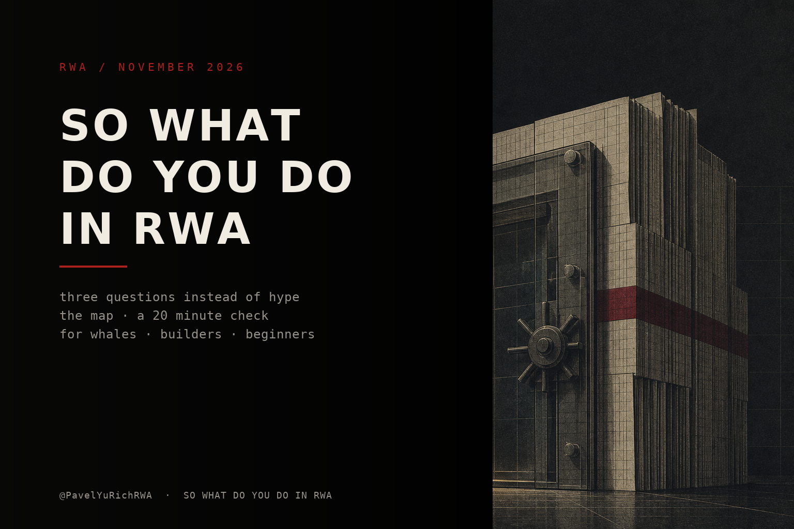
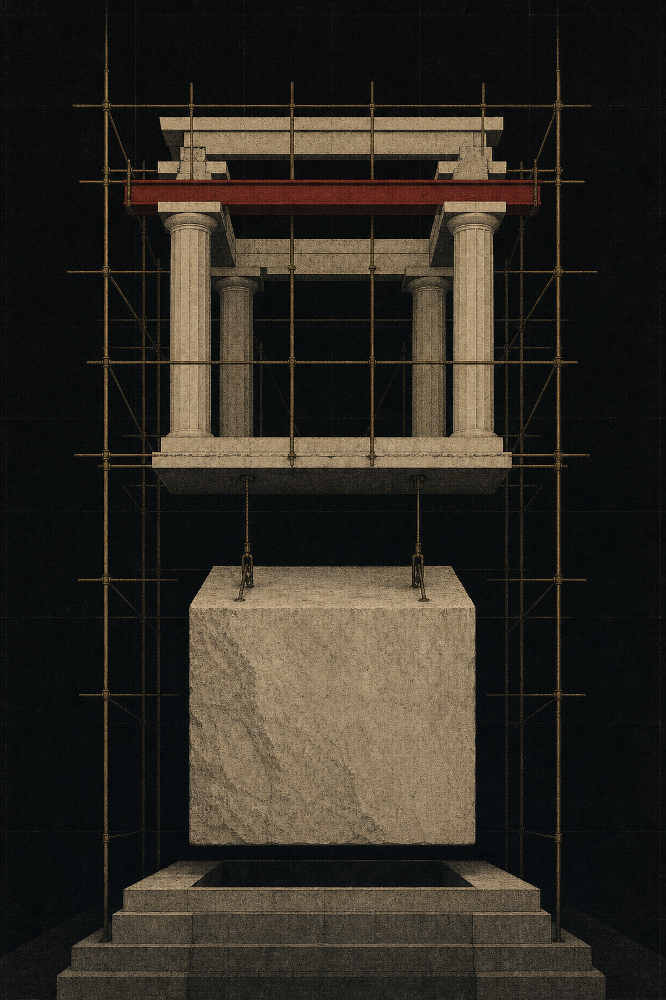

# So What Do You Actually Do in RWA

I spent almost a year explaining what RWA is. Enough, there is nothing left to explain: the market exists, the money arrived, the regulator wrote the permission, exchanges listed it, banks plugged in settlement. So let us get to the unpleasant part, which is what you do with it. Separately for someone hearing about it for the first time, separately for someone who already bought, separately for someone with enough on the balance to stop hunting yield and start creating it.

And the main thing first, so there are no illusions. RWA is not about buying an Apple share on a blockchain. RWA is about who keeps the record and who can rewrite it. Everything else, the yield, the listings, the integrations, is a layer on top of that one simple thing. Once you get it, the question of which RWA to buy gets a lot less interesting than the question of which floor of the building you are standing on.

Let us agree on the structure, because this is long. First the three questions that separate real RWA from a pretty token. Then the map, what sits where and what it pays. Then a twenty-minute check on any project. Then the part that matters if you are already in: the stack, the bottlenecks and where the margin lives. Then the whales, what to do with capital if you want influence and not just return. Then builders, if you want to issue something. And at the end, where this is going and what to do on Monday.

## Three questions that separate RWA from a token

Question one: who is the issuer and what does it physically hold. Not a partner, not a protocol, not a community. A legal entity with a custodian, an account and a license. If the site says the asset is backed but does not say by whom and where, that is not RWA, that is a wrapper with a logo.

Question two: what do you own in law. This is where adulthood starts. You can hold a share in an SPV, meaning an entity that holds the asset. You can hold a security entitlement, meaning a claim on a broker that holds the share for you. You can hold a plain claim against the token issuer, and that is not ownership, that is debt. And you can hold a governance token, which gives you a vote in a chat and nothing else. The difference between these four is not on-chain, it is in court. If the issuer fails tomorrow, you stand in a very different line of creditors in each case.

Question three: where is the exit and who closes it. Not we are working on secondary liquidity, but redemption in these terms, executed by this party, and here is what happens during a gate. In private credit the exit is often not a market but a window that opens on a schedule. That is fine, you just need to know it in advance and not on the day you need the money.

That is the whole filter. If all three have a straight answer, then look at yield. If not, looking at yield is pointless, because in that case it is not yield, it is a stake in somebody else's game.

## The map, what sits where

There are not many categories, and they differ by physics rather than by narrative. Here is a rough but honest map you can navigate without reading a hundred reports.

| Category | Yield | Minimum | Exit | Main risk |
|---|---|---|---|---|
| Treasuries and MMFs | 3 to 5% | $5,000 at OUSG, institutional at BUIDL | daily redemption at NAV | issuer and custodian |
| Gold (PAXG, XAUt) | none, plus DeFi add-ons | a few dollars | instant, the best secondary market here | custodian and bar audit |
| Tokenized equities | price plus dividends | $1 at Ondo | venue dependent, 24/7 minting at several | broker holding the shares, jurisdiction |
| Private credit | 8 to 15% | often $100,000 | lockups in months, almost no secondary | borrower and underwriter |
| Real estate | 7 to 12% rent | $50 | months | developer and manager |
| Funds and structures | 6 to 12% | per fund rules | per fund rules | manager and platform |

Three things you can see in that table that save you years.

First, yield is directly proportional to how hard it is to leave. Treasuries pay 3 to 5% because you exit the same day. Private credit pays 8 to 15% because you sit in a lockup and hope the underwriter did their job. That is not an inefficient market, that is an honest one, it pays you for what you are taking on.

Second, the only RWA with a genuine secondary market is gold. Tokenized Treasuries technically trade, but the volume is laughable because holders do not want to trade, they want to park cash. Equities come alive but thinly between sessions. Everything else is not a market, it is a queue.

Third, the size of a category tells you nothing about your chances. Tokenized private credit by broad counts is 12.9 billion, but freely transferable, actually buyable tokens are about 5 billion, the rest is locked inside platforms (breakdown: https://github.com/Ricosworks1/blockchain-payment-flow-analysis/releases/tag/deep-dive-onchain-private-credit-12-9b-reality-sept-2026). That is a seventy percent gap between the headline and the reality. So when somebody shows you TVL, do not ask how much, ask how much of it can I buy and sell.

For a beginner the starting set looks boring, and that is correct. Gold as the first token, because everything there can be checked with your own eyes: is there a bar audit, who is the custodian, how do you redeem. Treasuries as step two, because that is where you learn the difference between NAV and a promise. Equities as step three, because that is where the jurisdiction mess starts. Private credit strictly after you have learned to read documents instead of threads.

## The twenty-minute check

People send me projects asking whether it is worth it. Twenty minutes is almost always enough to see that there is nothing to look at. The order goes like this.

Open the site and find the legal entity. Not the brand, the entity with a registration number. Then find who custodies the underlying and check that this custodian exists separately from the website. If the underlying is a security, find the broker holding it. At Ondo, for example, it is Alpaca Securities, a registered US broker-dealer, and that single line is what separates a product from confetti (mechanics: https://www.quicknode.com/blog/tokenized-equities-2026).

Then find the redemption documents. Not the FAQ, the document itself: timelines, who executes, what happens in a gate, what the fees are. If there is no document, the exit is governed by support tickets, and that is not an exit, that is a negotiation.

Then look at the roles in the contract. Who can mint, burn, freeze, rewrite balances, change the rules. A proper security token has a pile of these, and that is not a bug, it is the price of legality. What matters is who holds them and whether a timelock sits in front. One EOA button means you are not in a security, you are in the founder's wallet.

Then check NAV. Who calculates it, how often, where the price in the contract comes from. For Treasuries it is an admin function, for credit it is a valuation, for equities it is an oracle between sessions. A mistake here costs more than any smart contract bug, because it is silent.

Then look at holders. Not TVL, the number of addresses and the distribution. A 2 billion fund with a hundred holders is not a market, it is ten families and their treasuries. And finally look at secondary turnover for the last thirty days. If there is none, whatever you bought, you bought forever.

Red flags you can spot instantly without digging. Dollar yield above twenty percent without leverage means somebody is paying you for a risk they will not name. Yield paid from token issuance is not yield, it is your own money handed back. A partnership with no signed document is a meme. An audit of the contract alone while the SPV, the custodian and the reserves go unmentioned is a classic. Promised shareholder rights without a place on the register, we did that movie for two years. And secondary liquidity later is not an answer, it is a postponement.

## For those already in. The stack, the bottlenecks, the margin

This is where it gets interesting, because buying BUIDL is not a position, it is cash management. A position appears when you see that the RWA market is five layers, and the money sits in them very differently.

Layer one, the manager or issuer. Holds the relationship with the borrower or the asset, takes a management fee. The most protected layer, because license and reputation, and the most boring.

Layer two, the tokenization platform and transfer agent. Securitize, Tokeny, Superstate, Centrifuge and company. They hold the register, run KYC, push NAV, service corporate actions. Thin margin, but it is an annuity, and switching costs live here because a register does not move.

Layer three, the risk manager, the curator. This is new and this is the interesting one. On Morpho, Aave Horizon and Kamino, a tokenized asset as collateral means somebody has to set the LTV, the concentration caps, the liquidation parameters and watch the NAV oracle. Steakhouse Financial, Gauntlet, Bitwise and a dozen new teams do this. Steakhouse runs around 1.6 billion across 48 plus vaults, Gauntlet around 1.2 billion, and Bitwise came in January 2026 as the first large traditional manager with its own vault (stack overview: https://app.rwa.xyz/blog/allocation-vaults-primer-for-institutional-asset-managers). That is the new prime brokerage, and it is being built right now by teams of twenty people.

Layer four, the lending protocol. Morpho, Aave, Kamino. Their job is technical, they take the spread. But they are what turns a token into collateral, and that is where RWA finally stops being a digital treasury.

Layer five, distribution. Coinbase, Kraken, Robinhood, MetaMask, banks, RIAs. This is where the real margin is, because a client does not choose between BUIDL and BENJI, he chooses between the app where his money already sits and the app he would have to fund. The example that explains everything: Coinbase's USDC yield product routes into Steakhouse-managed Morpho vaults on Base. The client sees an interest rate, the platform takes margin, the curator takes a fee, and the client never hears the word Morpho. Technology is not scarce in this market. Access to somebody else's balance sheet is.

Two conclusions if you are already in. First, the bottleneck is not the contract, it is servicing. Register, KYC, redemptions, taxes, corporate actions. People pay not for being on-chain but for not having to do this themselves. Second, if you want to be a participant rather than a customer, go into curation or distribution. There are already more issuers than there is money, and far fewer curators and channels than there are assets.

And separately on risk, because everybody makes the same mistake here. An RWA credit is not a DeFi pool. There is no liquidation bot that pulls you out in three blocks, there is a borrower who can simply not pay. So look at three things. Is there a public record of surviving an actual default rather than a nice model. How is subordination built, because a 15 to 30% junior tranche is the difference between a drawdown and a zero. And what is the concentration per borrower, because in Maple's history the same Orthogonal Trading default cost one pool 80% of deposits and another 17% (lessons: https://coinpaprika.com/education/rwa-default-events-defi/). Everything else, the APY, the partnerships, the logos, is decoration. And yes, Goldfinch wound down in June 2026 by a 100% vote after the token fell 99.8% from its high. That is part of this sector's history too, and it belongs in your head so you do not buy a pretty emerging market yield at the price of a risk you cannot size.

## For the whales. What to do with capital if you want influence

Here I will say something uncomfortable. Money is no longer the scarce thing in this sector. Underwriting, legal plumbing, servicing and distribution are. So I will put a million into a project is usually a way to buy yourself chores, not return.

What actually helps a small team, in descending order of usefulness.

Pay for what cannot be faked. Lawyers, the SPV, registration, audit, insurance. For a team that is 50 to 150 thousand at launch, for you it is the price of entry into a relationship where you are first in line next round. Just pay the providers directly, not a transfer to a wallet.

Provide liquidity with an honest lockup. Not I am in and out in a month, but I am in for a year and I will not flinch. That removes the main problem of a young RWA, where any sudden exit breaks the NAV and kills trust.

Buy a block in the redemption queue. Sounds ridiculous, but for a gated fund it is a rescue and for you it is an entry at a discount to NAV. That is a real service, and it gets paid.

Be a market maker around NAV. Not a speculator, the one holding the spread between the token and the base asset, especially outside market hours. No heroism here, just a premium for carrying risk everybody else avoids.

Fund year two. Everybody remembers year one, year two gets forgotten, and that is where KYC re-verification, reporting, corporate actions and support live. A project without money for year two dies quietly, with a great TVL.

Give the channel. Your audience, your desk, your clients, your broker access. This costs more than money and is not always for sale, which is exactly why it is the most valuable thing a whale can give.

And seventh, for the bravest. Take the first loss, meaning go into the junior tranche, and put a price on it. That is how a normal credit structure works, somebody absorbs the drawdown. Just do not pretend it is charity, this market likes risk named out loud.

One way not to help. Funding marketing and a listing. Six months later the project has a beautiful ticker, zero revenue and a line of people who want to exit first.

And the rule I will repeat in every post. If you help a young project, do not ask for a token as payment. You are personally creating the incentive to issue a useless asset just to pay you. If you want a share of the upside, take it in revenue, in structure, in a fee right, not in inflation.

## For builders. How to ship and what not to do

If you are reading this with the idea of I have an asset, let us tokenize it, here is the short truth.

Legal entity first, code second. Always. People who start with the contract rebuild the contract, because the structure changed. The wrapper is an SPV, a fund or a trust, and it decides who your investors are, what you can sell them and how you service it.

One asset, one jurisdiction, one distributor. Not three categories, not the whole world, not we will figure out compliance later. The first issuance exists to test operations, not to win everything.

Timelines and money, so you stop living in illusions: three to nine months from structure to first issuance, legal and structuring is the largest line in the budget, contract audit adds four to eight weeks, and the ERC-3643 standard already covers around 32 billion in assets and checks eligibility on every transfer (guide: https://restartfintech.com/blog/how-to-tokenize-real-world-assets-guide-fund-operators). Writing your own standard from scratch is almost always a mistake.

Do not start with US equities. Dense regulation, brutal competition, the highest disclosure bar. Start where you have real access to the paper and a manager with a real track record, and only then go to public markets.

Do not pay yield from issuance. If your yield is your token, you are not RWA, you are a DeFi scheme with a legal entity.

And model year two. Register servicing, KYC, reporting, taxes, corporate actions are not a one-off payment, they are a subscription to existence. Investors come for yield and leave over operations.

## Where this is going

Five things I am watching, and they will define the next year.

First, collateral. The fattest use of RWA is not holding paper, it is borrowing against it. Once NAV oracles and liquidation parameters become a standard instead of a curator's manual work, volume moves there. That is when RWA stops being a treasury and becomes a funding market.

Second, stablecoin reserves. A huge share of the crypto dollar is moving into 2a-7 funds with audits and reporting, and it happens quietly because it is dull. The winners here have a license and a fund, not a nice landing page.

Third, equities. Tokenized equities tripled during 2026 to roughly 3 billion on-chain, Ondo has more than 450 names and 1 billion TVL, xStocks has more than 25 billion cumulative volume across 110 plus countries (overview: https://crypticweb3.com/best-platforms-to-buy-tokenized-stocks-2026/). The next fight is not over listings, it is over the right to let people in or keep them out based on a passport.

Fourth, yield-bearing stablecoins. Around 8 billion by April 2026, up more than 300% in a year. Direct competition to Treasury tokens and the most user friendly form, because you do not have to choose anything.

Fifth, consolidation. The technology got cheap to zero, so the survivors are not the fastest but those with a register, a license, an audit and a sales channel. Curators and distributors will buy or squeeze out anyone who can only deploy.

## What to do on Monday

If you are new, buy a hundred dollars of gold and walk the whole path to redemption. Not because it is the best asset, but because every stage shows up there: KYC, custodian, fee, exit. Until you have done it with your hands, you know nothing.

If you are already in, pick one RWA credit and take it apart like an underwriter: borrower, concentration, tranches, default history, who curates. One case properly opened beats a hundred overviews.

If you are a whale, find a team that lacks lawyers and a year two rather than money, and pay for exactly that. Just do not ask for a token.

If you are a builder, delete everything from the roadmap except one asset, one jurisdiction and one distributor, and start with the legal entity.

And for all of us. The winner in this sector is not the one who designed the prettiest thing, it is the one who serviced somebody else's record the longest without screwing it up. Boring? Yes. But it pays.
